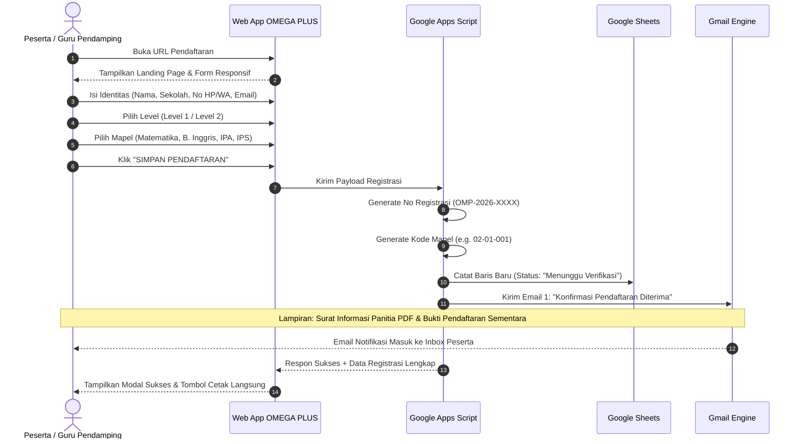
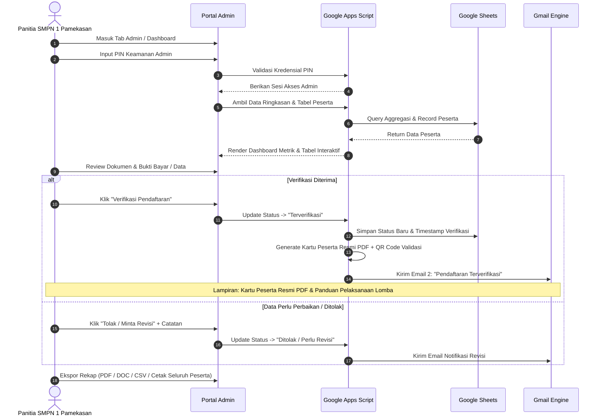

# PETA ARSITEKTUR & ALUR SISTEM (MAP.MD)
## Aplikasi Web Form Pendaftaran OMEGA PLUS
**Penyelenggara: SMP Negeri 1 Pamekasan | Sasaran: Siswa SD/MI Se-Madura**

---

### 1. Desain Arsitektur Sistem (High-Level Architecture)

Aplikasi dibangun menggunakan ekosistem **Google Workspace Platform** (Google Apps Script + Google Sheets + Google Drive + Gmail Service) yang menyajikan antarmuka Single Page Application (SPA) responsif modern tanpa ketergantungan server berbayar (Zero-Cost Infrastructure).

```mermaid
graph TD
    subgraph Klien / Browser
        LP[Landing Page & Navigasi]
        REG[Formulir Pendaftaran]
        TRK[Cek Status Pendaftaran]
        ADM[Dashboard & Manajemen Panitia]
    end

    subgraph Google Apps Script (Backend Core)
        CTRL[GAS Controller / doGet - doPost]
        AUTH[Admin Authenticator / PIN Engine]
        VAL[Validator & Number Generator]
        PDF_GEN[PDF Generator Engine]
        MAIL_ENG[Email Notification Engine]
    end

    subgraph Google Cloud / Workspace Database
        SS[(Google Spreadsheet Database)]
        DRIVE[(Google Drive: Assets & PDF Cache)]
        GMAIL[Gmail / MailApp Service]
    end

    LP --> REG
    LP --> TRK
    LP --> ADM

    REG -->|Submit Data via AJAX/Fetch| CTRL
    TRK -->|Query No. Pendaftaran| CTRL
    ADM -->|Kelola & Verifikasi Data| CTRL

    CTRL --> AUTH
    CTRL --> VAL
    VAL -->|Tulis Baris Baru| SS
    CTRL -->|Query & Update Status| SS

    VAL -->|Trigger Saat Daftar| MAIL_ENG
    AUTH -->|Trigger Saat Verifikasi| PDF_GEN
    PDF_GEN -->|Simpan Bukti & Kartu| DRIVE
    PDF_GEN --> MAIL_ENG
    MAIL_ENG -->|Kirim Email + Lampiran PDF| GMAIL
```

---

### 2. User Journey & Alur Pengguna (User Flow)

#### A. Alur Pendaftar (Peserta / Orang Tua / Guru Pendamping)



#### B. Alur Admin / Panitia Lomba



---

### 3. Struktur Route & Hierarki Tampilan (SPA View Hierarchy)

Aplikasi dirancang sebagai **Single Page Application** ultra-ringan dengan routing berbasis state internal di browser:

```
[ Root App: index.html ]
├── Header & Brand Bar
│   ├── Logo SMP Negeri 1 Pamekasan
│   ├── Judul: OMEGA PLUS
│   ├── Subtitle: Olimpiade Akademik SD/MI Se-Madura
│   └── Tab Navigasi:
│       ├── [Tab 1] Formulir Pendaftaran (Public)
│       ├── [Tab 2] Cek Status Pendaftaran (Public)
│       ├── [Tab 3] Dashboard Panitia (Admin Only)
│       ├── [Tab 4] Data Peserta (Admin Only)
│       └── [Tab 5] Laporan & Ekspor (Admin Only)
│
├── Container Konten Dinamis
│   ├── View: Formulir Pendaftaran (Form Input, Level, Multiple Mapel Checkbox, Action Buttons)
│   ├── View: Bukti Pendaftaran / Modal Cetak (Layout Kertas A4 Standar)
│   ├── View: Cek Status (Pencarian via No. Pendaftaran / No. HP / Email)
│   ├── View: Login Admin Modal (Input PIN Keamanan)
│   ├── View: Dashboard Panitia (7 Metric Cards, 2 Chart Progress Bars)
│   ├── View: Data Peserta (Pencarian Realtime, Filter Level, Filter Mapel, Tabel Interaktif)
│   ├── View: Modal Edit Peserta & Modal Konfirmasi Hapus
│   └── View: Laporan & Ekspor (Ekspor CSV, PDF Rekap, DOC Rekap, Cetak Blank Form)
│
└── Footer Bar
    ├── Identitas: "OMEGA PLUS · Semangat berprestasi, tumbuh bersama. ✦"
    └── Status Sinkronisasi Realtime dengan Spreadsheet
```

---

### 4. Skema Database Google Spreadsheet

Google Sheets bertindak sebagai RDBMS dengan 4 lembar kerja (Sheets):

```
Google Spreadsheet: [ DATABASE_OMEGA_PLUS_2026 ]
├── Sheet 1: "PESERTA" (Master Data Pendaftaran)
├── Sheet 2: "PENGATURAN" (Konfigurasi Event, Kuota, Kontak, PIN Admin)
├── Sheet 3: "LOG_EMAIL" (Audit Trail Pengiriman Email Notifikasi)
└── Sheet 4: "LOG_AKTIVITAS" (Audit Log Perubahan Status oleh Admin)
```

---

### 5. Pipeline Notifikasi Email & Generator PDF

1. **Email Stage 1: Pendaftaran Masuk (Immediate Trigger)**
   - **Trigger:** Sesaat setelah form pendaftaran disubmit dan tervalidasi.
   - **Penerima:** Alamat email peserta/guru pendamping yang diinput.
   - **Isi Email:** Ucapan terima kasih, detail pendaftaran, rincian nomor urut peserta tiap mata pelajaran, petunjuk pembayaran/tahapan verifikasi.
   - **Lampiran PDF 1:** *Surat_Informasi_Panitia_OmegaPlus.pdf* (Jadwal, tata tertib, kontak panitia).
   - **Lampiran PDF 2:** *Bukti_Pendaftaran_Sementara_[NoReg].pdf*.

2. **Email Stage 2: Verifikasi Admin (Admin Action Trigger)**
   - **Trigger:** Ketika panitia mengklik tombol "Verifikasi" di dashboard admin.
   - **Penerima:** Alamat email peserta.
   - **Isi Email:** Pemberitahuan bahwa berkas pendaftaran telah diverifikasi sah.
   - **Lampiran PDF:** *Kartu_Peserta_Resmi_[NoReg].pdf* yang memuat:
     * Pasfoto placeholder / box tanda tangan peserta.
     * QR Code verifikasi kehadiran saat hari H lomba.
     * Nomor peserta per mata pelajaran sesuai aturan sistem koding lomba.
